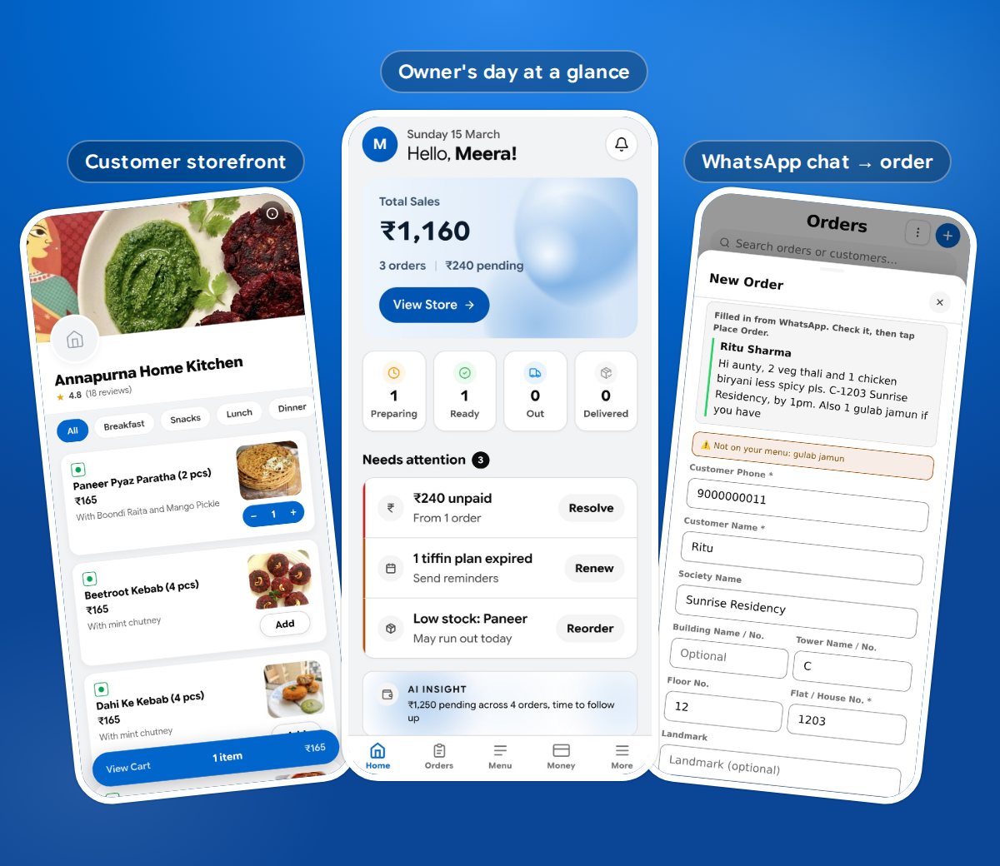

# Products I build with AI

**Nitin Rawal** · Some for real businesses, some just for fun. On every one, I own the product, the design, the testing and the release calls. [Claude Code](https://claude.com/claude-code) writes the code.

🌐 **Portfolio page:** [nrnitinrawal-2608.github.io/Products-Showcase](https://nrnitinrawal-2608.github.io/Products-Showcase/)

---

## OrdersIn

**The order book that already speaks WhatsApp.**
A mobile web app that runs the daily operations of a one-person food business: orders, billing, UPI payments, stock and customers, without asking anyone to change how they already work. In English, Hindi and Kannada.

🟢 Live in supervised beta with a real home kitchen.

**[Open the live app →](https://ordersin.co/app)** · [Product walkthrough (PDF)](assets/OrdersIn-Product-Walkthrough.pdf) · [ordersin.co](https://ordersin.co) · [Full write-up](https://github.com/nrnitinrawal-2608/ordersin)

Invite-only beta — the link is safe to click, but sign-in needs a code. The walkthrough PDF shows the whole product from the inside.

`React 19` `TypeScript` `Firebase` `Cloud Functions` `PWA`

---

**More on the way.** Each new project lands here when it's live.
