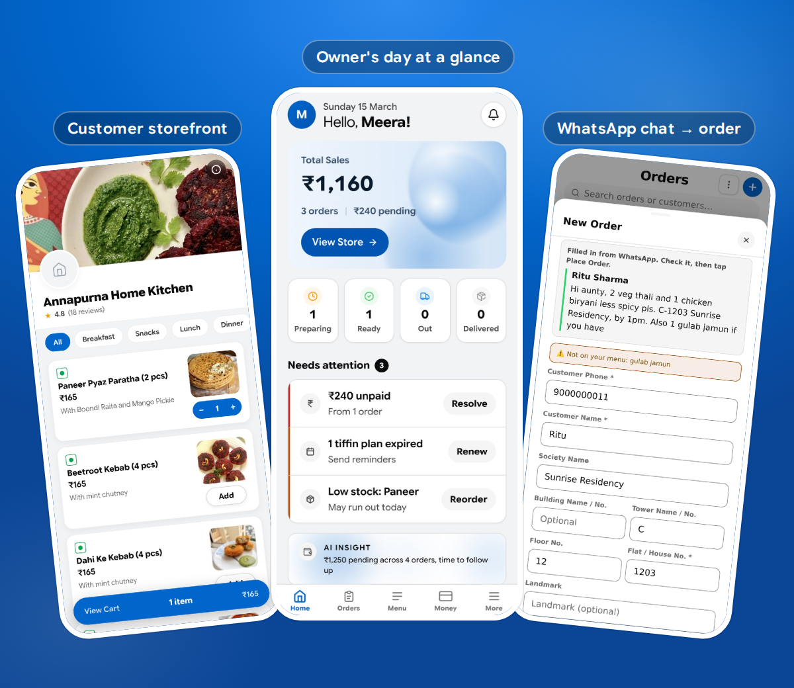
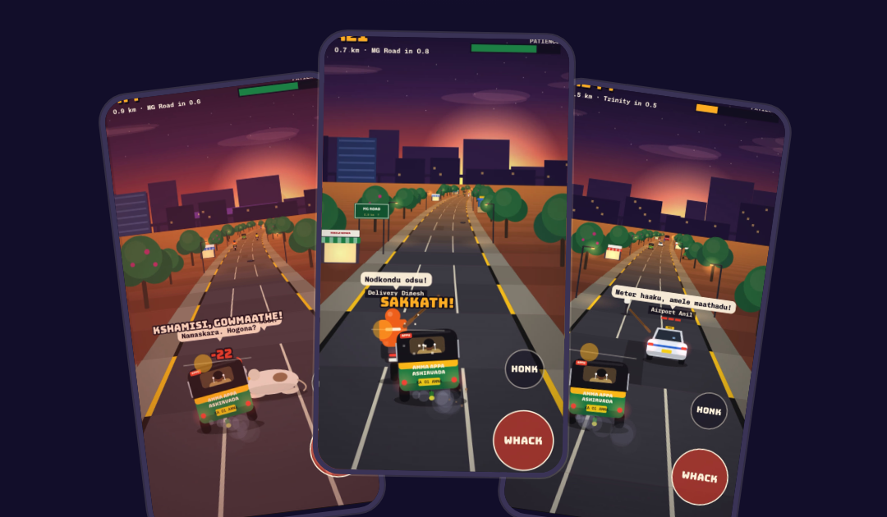

# Products I build with AI

**Nitin Rawal** · Some for real businesses, some just for fun. On every one, I own the product, the design, the testing and the release calls. [Claude Code](https://claude.com/claude-code) writes the code.

🌐 **Portfolio page:** [nrnitinrawal-2608.github.io/Products-Showcase](https://nrnitinrawal-2608.github.io/Products-Showcase/)

---

## OrdersIn

**The order book that already speaks WhatsApp.**
A mobile web app that runs the daily operations of a one-person food business: orders, billing, UPI payments, stock and customers, without asking anyone to change how they already work. In English, Hindi and Kannada.

🟢 Live in supervised beta with a real home kitchen.

**[Try the live app →](https://ordersin.co/app)** · [Product walkthrough (PDF)](assets/OrdersIn-Product-Walkthrough.pdf) · [ordersin.co](https://ordersin.co) · [Showcase repo](https://github.com/nrnitinrawal-2608/ordersin)

`React 19` `TypeScript` `Firebase` `Cloud Functions` `PWA`

---

## Auto Rash

**Road Rash, but you're a Bangalore auto driver. Majestic to Silk Board.**
A browser game with a lathi, potholes, metro stations and a cow you must never hit. Under the hood: a cheat-proof Firebase leaderboard, nickname-only data, an A+ security rating, and every release auto-published to itch.io.

🛺 Side project, made for fun. Works best on a phone.

**[Play on itch.io →](https://gobicat.itch.io/auto-rash)** · [How it was built (PDF)](assets/Auto-Rash-How-It-Was-Built.pdf)

`JavaScript` `Canvas` `Web Audio` `Firebase` `GitHub Actions`

*The game's code is private; the PDF shows how it was built.*

---

**More on the way.** Each new project lands here when it's live.
